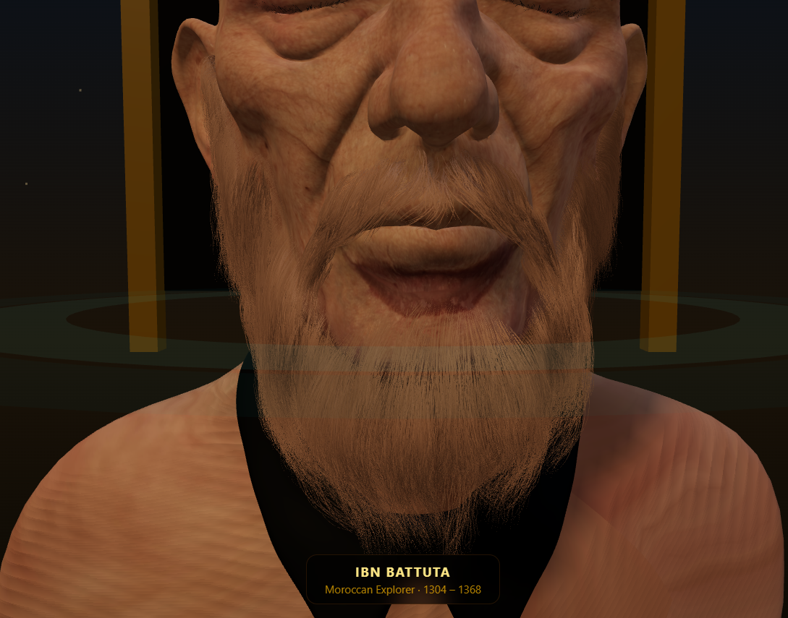
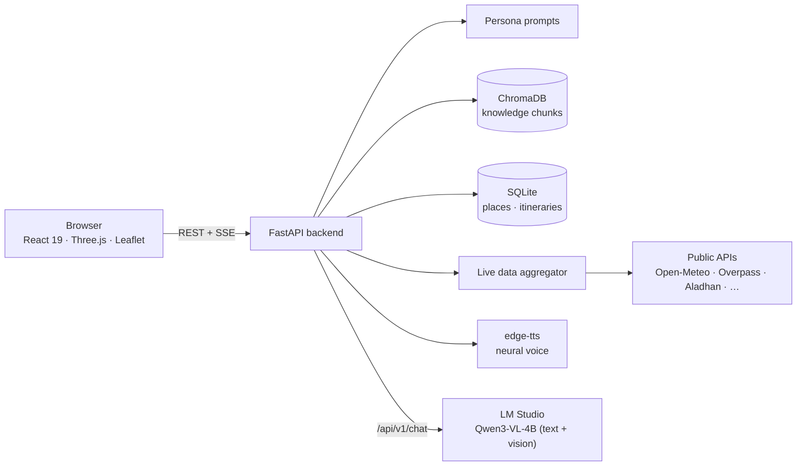

# Ibn Battuta — AI Historical Tourist Guide

A multimodal AI travel companion embodied as a 3D avatar of the 14th‑century Moroccan explorer **Ibn Battuta**. Ask him questions by text, voice or photo. He answers in character, grounded in a curated city knowledge base and live local conditions (weather, prayer times, events, news), speaks the reply aloud with lip‑synced animation, and can plan a full multi‑day itinerary for you.

Everything AI runs locally: a vision‑language model (Qwen3‑VL‑4B) served by [LM Studio](https://lmstudio.ai), with no paid cloud API.

<p align="center">
  
</p>

---

## Features

- **Conversational persona.** Chat with Ibn Battuta, whose tone and recommendations come from a dedicated persona prompt layer. Replies stream token by token over Server‑Sent Events (SSE).
- **Photo questions.** Upload a picture of a landmark; the image and your question go to the vision model together for recognition and explanation.
- **Voice in, voice out.** Speak your question (browser speech recognition), and hear the answer through Microsoft Edge neural TTS voices (English and French).
- **3D avatar with runtime lip‑sync.** A GLB bust rendered with React Three Fiber. The jaw region is found by scanning the mesh's vertices and deformed every frame from the energy of the playing audio, so no pre‑made facial animation is needed.
- **Grounded answers (RAG).** A ChromaDB vector store with `all-MiniLM-L6-v2` embeddings holds per‑city knowledge chunks tagged with category and keyword metadata, filtered by the city you're in.
- **Location awareness.** Your GPS position is mapped to the nearest supported city (within 150 km), and the persona, knowledge retrieval and live data all follow it.
- **Live local data.** Weather, air quality, prayer times, public holidays, country info, Wikipedia summary, nearby restaurants/attractions/hotels, news headlines and events, fetched in parallel and cached for 10 minutes.
- **AI itinerary builder.** A three‑pass LLM pipeline (plan → select real places from the database → narrate each stop in the guide's voice) streams progress to the page as each day is built. Itineraries are saved with a private edit link and a read‑only share link.
- **Maps and walking mode.** Leaflet maps of landmarks with walking navigation, next to the chat and avatar.

## Architecture



### What happens when you ask a question

1. The browser sends your message, plus an optional photo (base64) and your GPS coordinates, to `POST /api/v1/chat/stream`.
2. The backend resolves your city: an explicit city if given, otherwise the nearest known city to your coordinates.
3. Live data for that city is fetched in parallel (8 workers, 10‑minute cache) and formatted into a context block.
4. For text questions, the best‑matching knowledge chunks for that city are retrieved from ChromaDB.
5. The persona prompt, city, live data and retrieved knowledge are combined into a system prompt and sent to LM Studio. The reply streams back to the browser.
6. The finished reply goes to `POST /api/v1/tts`. While the MP3 plays, a Web Audio `AnalyserNode` measures loudness each frame and drives the avatar's jaw.

### Itinerary pipeline

| Pass | Input | Output |
|---|---|---|
| 1. Plan | City, number of days, interests, pace, budget, party size, notes | `{ title, days: [{ day, city, theme }] }` as JSON |
| 2. Select | Each day's theme + candidate places from the database | 3–5 real places per day, ordered, with start times and durations |
| 3. Narrate | Each day's stops + a RAG snippet per place | A one‑line day summary and a 60–110 word in‑character paragraph per stop |

The small local model has no reliable JSON mode, so structured output goes through a parser that strips Markdown fences, extracts the first balanced JSON value by bracket depth, and retries once with a stricter prompt if parsing fails.

## Tech stack

| Layer | Technologies |
|---|---|
| Frontend | React 19, Vite 7, React Router 7, Tailwind CSS 4, Framer Motion, React Three Fiber / Three.js / drei, React‑Leaflet, lucide‑react |
| Backend | FastAPI, Uvicorn, SQLAlchemy (SQLite), Pydantic Settings, requests / httpx |
| AI | Qwen3‑VL‑4B via LM Studio's REST API, ChromaDB, sentence‑transformers (`all-MiniLM-L6-v2`), edge‑tts |
| Live data | Open‑Meteo (weather, air quality), Overpass / OpenStreetMap (POIs, venues), Aladhan (prayer times), Nager.Date (holidays), REST Countries, Wikipedia REST, RSS news (BBC, Al Jazeera, Reuters, Hespress, TelQuel, Yabiladi), Guichet.com and optionally Ticketmaster (events) |

## Getting started

### Prerequisites

- **Python 3.10+** (developed on 3.13)
- **Node.js 20.19+** (required by Vite 7)
- **[LM Studio](https://lmstudio.ai)** with the `qwen/qwen3-vl-4b` model downloaded
- A Chromium‑based browser (Chrome or Edge) for voice input

### 1. Start the model server

In LM Studio, download **Qwen3‑VL‑4B** (`qwen/qwen3-vl-4b`) and start the local server on the default port **1234**. The backend talks to LM Studio's native endpoint at `http://127.0.0.1:1234/api/v1/chat`.

### 2. Run the backend

```bash
cd backend
python -m venv .venv
# Windows: .venv\Scripts\activate    macOS/Linux: source .venv/bin/activate
pip install -r requirements.txt

uvicorn app.main:app --reload --port 8000
```

On first start the backend creates `backend/app.db` and seeds a starter catalogue of places. Interactive API docs are at <http://127.0.0.1:8000/docs>.

### 3. Build the knowledge base

Run from `backend/` with the virtual environment active. The embedding model (~80 MB) downloads automatically the first time.

```bash
# Curated knowledge in app/data/*_data.txt (Tangier, Marrakech) → ChromaDB
python -m app.core.rag

# Optional: Wikipedia + Wikivoyage articles → ChromaDB, and OpenStreetMap POIs → SQLite
# for Tangier, Tetouan, Chefchaouen, Asilah and Fnideq
python scripts/ingest_morocco.py            # add --dry-run to preview, --cities Tangier to limit
```

The vector store is written to `chroma_db/` at the repository root.

### 4. Run the frontend

```bash
cd frontend
npm install
npm run dev
```

Open <http://localhost:5173>. The chat, avatar and map are on the **Walk** page (`/walk`). Allow location access if you want answers tailored to where you are.

### 5. Optional: Ticketmaster events

Event listings work without any key (OpenStreetMap, RSS and Guichet.com). To add Ticketmaster results, copy `.env.example` to `.env` **in the repository root** and set `TICKETMASTER_API_KEY` ([free key](https://developer.ticketmaster.com)).

## Configuration

Most settings are constants in the code for now:

| Setting | Location | Default |
|---|---|---|
| LM Studio URL | `backend/app/core/llm.py` → `LM_STUDIO_HOST` | `http://127.0.0.1:1234` |
| Model | `backend/app/core/llm.py` → `MODEL_NAME` | `qwen/qwen3-vl-4b` |
| Database | `backend/app/db/session.py` → `DATABASE_URL` | `sqlite:///./app.db` |
| Vector store path | `backend/app/core/rag.py` → `DB_DIR` | `chroma_db/` at repo root |
| Supported cities for GPS lookup | `backend/app/core/location.py` → `KNOWN_CITIES` | Tangier, Marrakech, Casablanca, Fes, Rabat, Cairo, Paris, Rome, Barcelona, Istanbul, Dubai |
| TTS voices | `backend/app/api/api_v1/endpoints/tts.py` → `VOICE_MAP` | `en-GB-RyanNeural`, `fr-FR-HenriNeural` |
| Backend URL used by the frontend | `ChatContainer.jsx`, `Create.jsx`, `useItinerary.js`, `useTangierLive.js` | `http://127.0.0.1:8000` |
| Ticketmaster API key | `.env` at repo root → `TICKETMASTER_API_KEY` | unset |

## API reference

All routes are under `/api/v1`.

| Method | Path | Description |
|---|---|---|
| `GET` | `/health` | Liveness check |
| `POST` | `/chat` | Chat with the guide; returns `{ response, city, live }` |
| `POST` | `/chat/stream` | Same as `/chat`, streamed over SSE |
| `POST` | `/tts` | Text → MP3 (`audio/mpeg`) |
| `GET` | `/places` | List places in the catalogue |
| `GET` | `/places/{place_id}` | Get one place |
| `POST` | `/itineraries/generate` | Generate an itinerary; streams progress events over SSE |
| `GET` | `/itineraries/{token}` | Fetch an itinerary by edit or view token |
| `PATCH` | `/itineraries/{edit_token}` | Update itinerary details |
| `POST` | `/itineraries/{edit_token}/stops` | Add a stop |
| `DELETE` | `/itineraries/{edit_token}/stops/{stop_id}` | Remove a stop |
| `POST` | `/itineraries/{edit_token}/regenerate-stop/{stop_id}` | Regenerate one stop with the LLM |

Chat request body:

```json
{
  "message": "What should I see near the Kasbah?",
  "image_data": "data:image/jpeg;base64,...",
  "latitude": 35.7878,
  "longitude": -5.8128,
  "city": "Tangier"
}
```

Only `message` is required.

## Frontend pages

| Route | Page |
|---|---|
| `/` | Landing page |
| `/walk` | Chat, 3D avatar, live panel and walking map |
| `/create` | Itinerary builder with live generation progress |
| `/itinerary/:token` | Edit a saved itinerary |
| `/shared/:token` | Read‑only shared itinerary |
| `/itineraries` | My Journeys and curated examples |
| `/live` | Live city dashboard (weather, prayer times, events, news) |
| `/field-guide` | Neighbourhood field guide |
| `/about` | About the project |

## Project structure

```
.
├── backend/
│   ├── app/
│   │   ├── api/api_v1/endpoints/   # chat, tts, places, itineraries, health
│   │   ├── core/                   # LLM client, RAG, live data, location, persona prompts
│   │   ├── data/                   # curated city knowledge (*_data.txt)
│   │   ├── db/                     # session, table creation, place seeding
│   │   ├── models/ schemas/ crud/  # ORM models, Pydantic schemas, DB helpers
│   │   └── services/               # three-pass itinerary generator
│   ├── scripts/ingest_morocco.py   # Wikipedia / Wikivoyage / OSM ingestion
│   ├── database_schema.sql
│   └── requirements.txt
├── frontend/
│   ├── public/models/ibn-battuta/  # avatar model (GLB)
│   └── src/
│       ├── pages/                  # route components
│       ├── components/             # chat, avatar, map, live panel, UI primitives
│       └── hooks/                  # geolocation, itineraries, live data
├── *.py                            # standalone LM Studio / vision debugging scripts
└── *.md                            # design notes and reports (see below)
```

## Known limitations

- The backend URL and LM Studio settings are hard‑coded rather than read from environment variables.
- There is no authentication, and CORS allows all origins. Treat this as a local development setup.
- Voice input relies on the browser's Web Speech API (Chrome/Edge) and listens in English.
- There's no automated test suite yet. Planned backend and frontend tests are described in `.claude/tasks/16-*` and `17-*`.
- Landmark recognition is strongest for Moroccan sites and weaker for landmarks elsewhere (see `TASK_PLAN.md`).

## Further documentation

| Document | Contents |
|---|---|
| [CV_PROJECT_SUMMARY.md](CV_PROJECT_SUMMARY.md) | Project summary and engineering highlights |
| [wholeProject.md](wholeProject.md) | Original product blueprint |
| [implementation_plan.md.resolved](implementation_plan.md.resolved) | First MVP scope (Tangier only) |
| [TASK_PLAN.md](TASK_PLAN.md) | Roadmap for location‑aware landmark recognition |
| [RAG_OPTIMIZATION_REPORT.md](RAG_OPTIMIZATION_REPORT.md) | Chunking and metadata design for the knowledge base |
| [backend/rag_design.md](backend/rag_design.md) | Embedding model and vector store choices |
| [IMAGE_UPLOAD_FEATURE.md](IMAGE_UPLOAD_FEATURE.md) | How photo questions work end to end |
| [IMAGE_UPLOAD_DEBUG_GUIDE.md](IMAGE_UPLOAD_DEBUG_GUIDE.md) | Troubleshooting image uploads |
| [documentation.md](documentation.md) | LM Studio `/api/v1/chat` reference |
| [.claude/tasks/](.claude/tasks/) | Feature‑by‑feature implementation tasks (order in `.claude/ORDER.md`) |

## Credits

- 3D avatar bust generated with [Meshy AI](https://www.meshy.ai).
- Map data © [OpenStreetMap](https://www.openstreetmap.org/copyright) contributors.
- Knowledge sources include [Wikipedia](https://www.wikipedia.org) and [Wikivoyage](https://www.wikivoyage.org) (CC BY‑SA).
